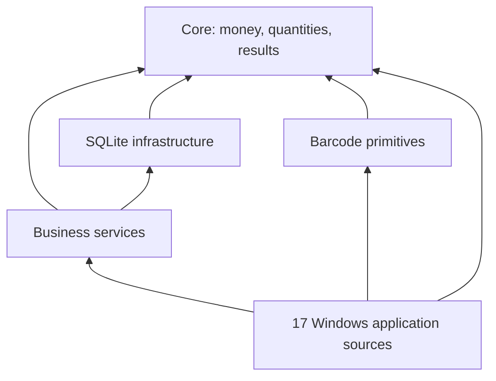

# Xzare Business Engine

**Arabic-first business software foundations: exact money, transactional SQLite, barcode input and shared desktop services.**

[الشرح بالعربية](REPOSITORY-AR.md) · [Getting started](docs/GETTING_STARTED.md) · [Contributing](CONTRIBUTING.md) · [Security](SECURITY.md) · [Roadmap](ROADMAP.md)

Xzare extracts common business rules into four TypeScript packages. A sale, stock movement or payment should use the same checked arithmetic, permissions and transaction boundaries wherever it appears. This repository includes 17 Windows application sources that exercise these foundations across different workflows.

The focus is Arabic-speaking businesses and developers: Arabic numeric input, right-to-left interfaces, local data and workflows that can operate without a continuous connection. Money currently models Egyptian pounds as integer piastres; it is **not** a general foreign-exchange engine.

## Project status

Early public source release, maintained by [Xzare](https://github.com/yousefbadran6888-ux). This is implementation code with tests, alongside historical design and operating documents; it is not a certification that every application is ready for customer deployment.

- **Implemented source:** four shared packages and 17 applications listed below.
- **Design only:** product 18, Property Manager. Products 19–30 remain a roadmap.
- **Local baseline, 22 October 2026:** TypeScript checks and 696 tests across 109 files passed before this public-source preparation. This records a local result, not an independent audit or the latest CI status. See [verification scope](docs/VERIFICATION.md).
- **Distribution boundaries:** no customer databases, signing secrets or installers are included. Production activation hosting, publisher signing and physical-device acceptance remain separate deployment work.

## Shared packages

| Package | Responsibility |
| --- | --- |
| [`@xzare/core`](packages/core/src/index.ts) | Money, quantities, rounding, allocation, results, errors, IDs, clocks and redaction |
| [`@xzare/db`](packages/db/src/index.ts) | SQLite connections, migrations, integrity checks and transactions |
| [`@xzare/barcode`](packages/barcode/src/index.ts) | Checked identities, scale-label decoding and scanner framing |
| [`@xzare/engine`](packages/engine/src/index.ts) | Identity, permissions, commerce, stock, cash, industry services, backup and licensing |



Workspace packages are not published to npm. Their `private` manifest fields prevent accidental npm publication and do not restrict the source license.

## Try the core

Use **Windows x64**, **Node.js 24** and **pnpm 10.12.1** for the full-workspace path. Windows-specific native dependencies currently prevent claiming full macOS/Linux support.

```sh
git clone https://github.com/yousefbadran6888-ux/xzare-business-engine.git
cd xzare-business-engine
npm install --global pnpm@10.12.1
pnpm install --frozen-lockfile --ignore-scripts
pnpm build
node examples/core-money.mjs
pnpm verify
```

The example needs no activation server, customer database or payment account:

```js
import { Money } from './packages/core/dist/index.js'

const amount = Money.parse('١٢٣٤٫٥٠')
if (!amount.ok) throw amount.error
console.log(Money.toPiastres(amount.value)) // 123450
console.log(Money.toDecimalString(amount.value)) // 1234.50
const parts = Money.allocate(Money.fromPiastres(100), [1, 1, 1])
console.log(parts.map(Money.toPiastres)) // [34, 33, 33]
```

Read [Getting started](docs/GETTING_STARTED.md) for native dependencies and desktop activation boundaries. A successful build does not imply a ready-to-use activated desktop installation.

## Included applications

| Area | Source applications |
| --- | --- |
| Commerce and operations | POS, Restaurant, Accounting, Inventory, Manufacturing |
| Repair and services | Workshop, Service Center |
| Health workflows | Clinic, Laboratory, Pharmacy |
| People and customers | HR, CRM, Education, Gym, Salon |
| Hospitality and property | Hotel, Real Estate |

The [portfolio](docs/PRODUCT_PORTFOLIO.md) distinguishes existing sources from planned products. Healthcare and financial workflows require domain-specific acceptance before real use; no regulatory certification is claimed.

## Contribute

Useful first contributions include Arabic/English documentation corrections, reproducible numeric-input edge cases, barcode compatibility reports and focused regression tests. See [CONTRIBUTING.md](CONTRIBUTING.md). Arabic and English contributions are welcome. Do not include real customer or patient data in issues or tests.

The [verification workflow](.github/workflows/verify.yml) runs installation, type checking, tests and the core example on Windows. See its actual status on [GitHub Actions](https://github.com/yousefbadran6888-ux/xzare-business-engine/actions/workflows/verify.yml).

## Documentation

- [Architecture](ARCHITECTURE.md), [roadmap](ROADMAP.md) and [maintainers](MAINTAINERS.md)
- [Core security boundaries](docs/CORE_SECURITY.md) and [private vulnerability reporting](SECURITY.md)
- [Barcode formats and scanner setup](docs/BARCODE_ENGINE.md)
- [Historical activation/deployment guide](docs/ONLINE_LICENSING.md)
- [Source license and third-party boundaries](docs/OPEN_SOURCE.md)

## License and contact

Copyright © 2026 Xzare Software Solutions and contributors. First-party source and documentation in this revision are licensed under **GNU AGPL-3.0-only**, except files with their own third-party license notices. See [LICENSE](LICENSE) and [NOTICE](NOTICE).

The license permits use, modification and redistribution under its terms. Historical paid-activation descriptions do not impose additional conditions on source-code rights. Xzare names and logos do not grant endorsement of third-party distributions.

Contact: [hello@xzare.com](mailto:hello@xzare.com). Report non-security problems through [Issues](https://github.com/yousefbadran6888-ux/xzare-business-engine/issues).
